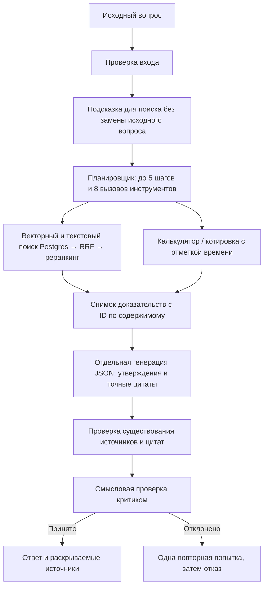

# Evidence-backed RAG MCP agent

Ассистент по внутренним документам: ищет подтверждения, отвечает с цитатами,
умеет считать и явно отказывается от неподтверждённого ответа. HTTP, веб-чат и
MCP используют один проверяемый контракт. Python 3.12+, Postgres/pgvector,
Groq, Cohere или локальные sentence-transformers; без LangChain.

Это основа для пилота с одной базой знаний. Не заявляется нулевой уровень
галлюцинаций или готовность к многопользовательскому SaaS.

## Как формируется ответ



Свободный текст планировщика не выдаётся пользователю. Каждый факт в ответе
должен иметь источник и точную цитату. Это проверяет происхождение, а не
доказывает истинность: критик может ошибиться, а исходный документ может быть
неверным или устаревшим. При противоречиях модель должна показать обе цитаты;
при недостатке доказательств — вернуть `insufficient_evidence`.

Разделение планирования и генерации нужно, в частности, потому что Groq
не поддерживает tool use вместе со Structured Outputs в одном вызове.
[Документация Groq](https://console.groq.com/docs/structured-outputs).

## Быстрый запуск

```sh
python3.12 -m venv .venv
source .venv/bin/activate
pip install -r requirements-local.txt
cp .env.example .env
# Заполните GROQ_API_KEY, DATABASE_URL и API_KEY.
# Для локального демо вместо API_KEY можно явно задать DEMO_MODE=true.
python -m src.ingest
uvicorn src.api:app --reload
```

Postgres должен поддерживать pgvector и Unicode-aware LC_CTYPE (например,
`en_US.UTF-8`). `init_schema()` проверяет регистр кириллицы и размерность вектора.
Cohere-режим: установите `requirements.txt`, задайте `USE_COHERE=true` и
`COHERE_API_KEY`, затем запустите индексацию. Он не требует загрузки torch.

`constraints.txt` фиксирует проверенный набор зависимостей. MCP устанавливается
через `requirements-mcp.txt`; тесты и линтер — через `requirements-dev.txt`.
Локальные ML-модели устанавливаются отдельно и требуют дополнительной памяти.

## API и результат

`POST /agent/ask` принимает `question` и необязательную историю `{role, content}`.
При настроенном `API_KEY` требуется заголовок `X-API-Key`.

```json
{
  "answer": "Откат обычно занимает не больше 3 минут. [1]",
  "status": "answered",
  "reason": null,
  "sources": [{"id": "content-hash", "source": "data/deployment.txt", "content": "...", "kind": "document", "citation": 1}],
  "claims": [{"text": "...", "citations": [{"evidence_id": "content-hash", "quote": "..."}]}],
  "stats": {"total_llm_calls": 6}
}
```

Это иллюстрация контракта, не результат измерения. Статусы: `answered`,
`insufficient_evidence`, `blocked`; сбой зависимостей даёт HTTP 503.
`/rag/ask` использует фиксированный поиск с теми же проверками.
`/agent/ask-raw` — устаревший совместимый алиас с обязательной проверкой.
`/health` — только liveness, без проверки провайдеров.

История ограничена 10 сообщениями и 16 000 символов; проверяются роли во всех
входных сообщениях. Ошибки внешних сервисов не раскрывают DSN или сырые исключения.
Лимит 20 запросов/мин и 5 выполняющихся цепочек действует на один процесс.
В режиме общего ключа пользователи делят один лимит; для персональных квот нужен
внешний шлюз с идентификацией пользователей.

## MCP

```sh
pip install -r requirements-mcp.txt
python -m src.mcp_server
# Запускать из корня проекта с корректным окружением:
claude mcp add --transport stdio rag-agent -- python -m src.mcp_server
```

Официальный Python SDK v2 (`mcp==2.3.0` в constraints). Tools: `ask_agent`,
`ask_agent_fast` (одна попытка, проверка остаётся), `search_documents` (`k=1..20`),
`rag_answer`, `get_stock_quote`. Транспорт stdio; удалённый HTTP MCP с OAuth
не реализован. Содержимое retrieved-документов — недоверенные данные.
[Официальный SDK](https://github.com/modelcontextprotocol/python-sdk).

## Проверки и оценка качества

```sh
pip install -r requirements-dev.txt
ruff check src tests
ruff format --check src tests
python -m pytest -q
# Только отдельная одноразовая тестовая БД: тесты переиндексируют её!
RAG_TEST_DATABASE_URL=postgresql://localhost/rag_test python -m pytest -q
# Живой прогон: требует ключи и заполненный индекс, расходует API-квоту.
python -m src.eval --output eval-results.json
```

Набор `evals/golden.json` содержит 35 случаев по документам, арифметике и вопросам
без ответа. Eval вызывает основной pipeline ровно один раз на случай и проверяет
его фактический снимок доказательств. Считает успешность ответов на разрешимые
вопросы, отказы на неразрешимые, faithfulness среди ответов, coverage и сбои.
Всегда отказывающийся агент не проходит. Любой неуспешный случай даёт ненулевой
exit code. Это стартовый набор, не статистически значимый независимый benchmark.

Старые цифры «100% retrieval / 75% faithfulness» удалены: 4 вопроса и иной путь
генерации не подтверждали качество основного API. Текущий live-score пока не измерен.

## Модели и retrieval

- Поиск: pgvector + индексированный Postgres FTS (`russian` и `simple`), RRF,
  затем до 30 кандидатов на реранкинг. FTS использует `ts_rank_cd`, это не BM25.
- `LLM_MODEL` и `CRITIC_MODEL` настраиваются независимо. Базовая генерация —
  `openai/gpt-oss-20b`; смена на другую модель требует поддержки JSON Schema
  и собственного eval, а не предположения, что модель всегда лучше.
- Cohere-реранкер — настраиваемый `rerank-v5.0-fast`; `pro` стоит сравнить на
  своих данных. Семейство v5 указано в
  [актуальной документации Cohere](https://docs.cohere.com/docs/rerank-overview).
- Embedding-модель сохранена: молчаливая замена делает существующий индекс
  несовместимым. Идентификатор модели и размерность хранятся вместе с индексом.
- `MIN_RERANK_SCORE` — предварительный порог, не вероятность правильности.
  Его нужно калибровать отдельно для каждой модели на отложенных примерах.

## Деплой и обновление существующего сервиса

1. Создать staging-базу/ветку Neon с корректной локалью. Выполнить `python -m src.ingest`
   против неё: появятся текстовый индекс и metadata. Старый индекс без metadata
   не будет использоваться. Полная переиндексация атомарна, но блокирует читателей;
   для большого корпуса нужен отдельный индекс с последующим переключением.
2. На Render задать `API_KEY`, ключи провайдеров, `DATABASE_URL`, `ALLOWED_ORIGIN`.
   Без ключа HTTP закрыт, если явно не выбран `DEMO_MODE=true`.
3. На Vercel в `web/` задать `RAG_AGENT_API_URL` и **server-only**
   `RAG_AGENT_API_KEY` с тем же значением. Прокси передаёт ключ сервер-сервер.
4. Выполнить live-eval на staging, проверить источники в чате и стоимость запросов.
   Только после этого переключать production на новый код и подготовленный индекс.

Публичный веб-прокси остаётся демо-входом: серверный ключ защищает прямой backend,
но не авторизует посетителя сайта. Для закрытой базы знаний необходима сессионная
авторизация веб-прокси; не публикуйте через него конфиденциальные документы.

## Границы и следующий этап

Количество ролей само по себе не обеспечивает качество. До 16 LLM-вызовов при
двух полных попытках; один вызов ограничен таймаутом и выходными токенами.
Стоимость в stats — оценка только успешных LLM-вызовов, без Cohere и инфраструктуры.
Таймаут веб-прокси не отменяет уже запущенную синхронную работу backend.

Следующий продуктовый этап: подключение реального источника документов,
обновление/удаление с сохранением версий, права доступа до retrieval, независимый
набор вопросов, измерение качества/стоимости/p95. Multi-tenant/RLS, OAuth для
удалённого MCP, распределённые квоты и observability пока не реализованы.
Подробный аудит и приоритеты: [docs/AUDIT-2026-11-05.md](docs/AUDIT-2026-11-05.md).
